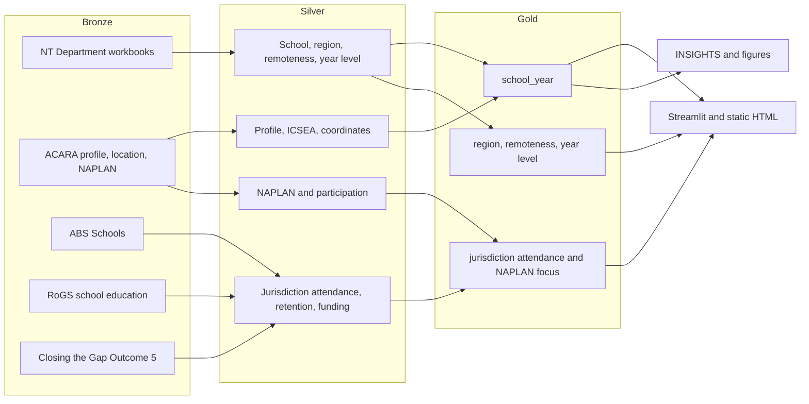
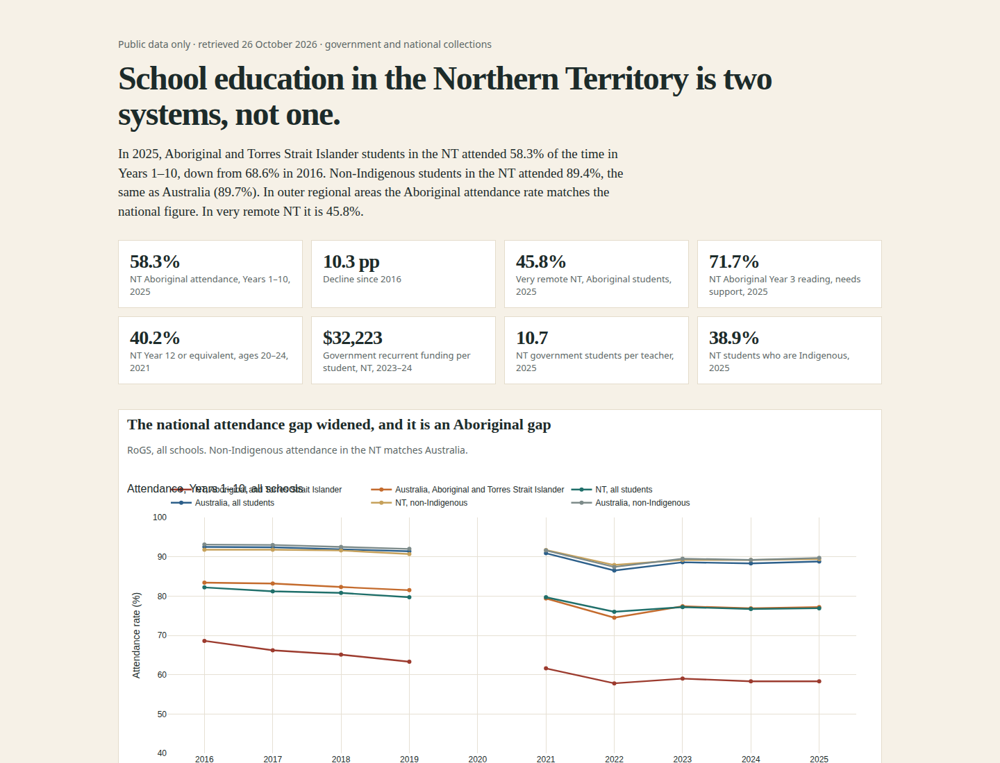
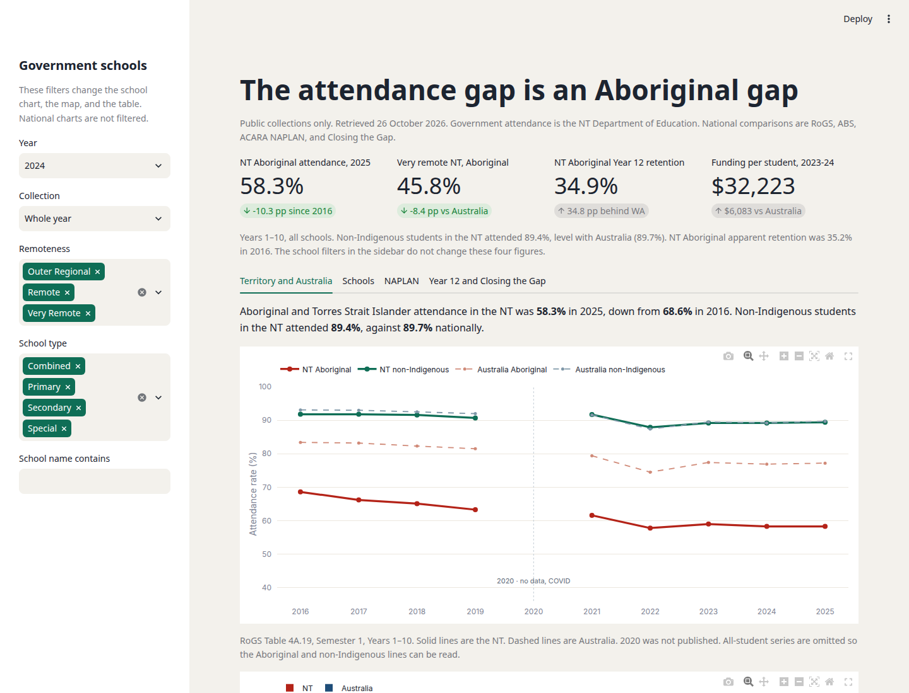
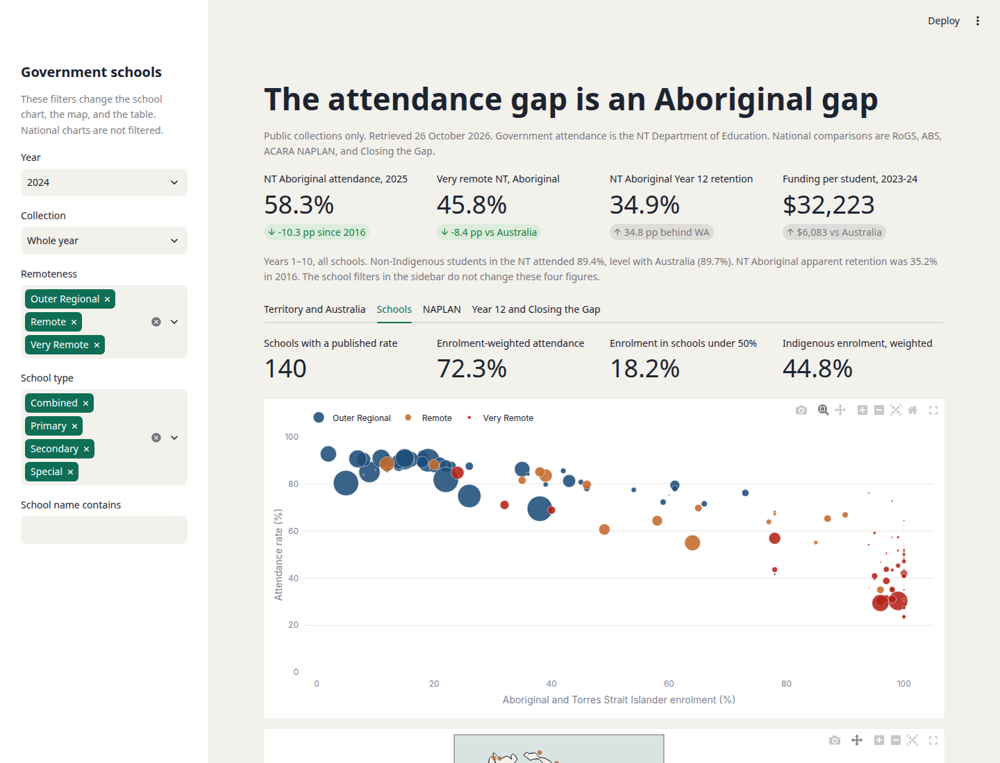
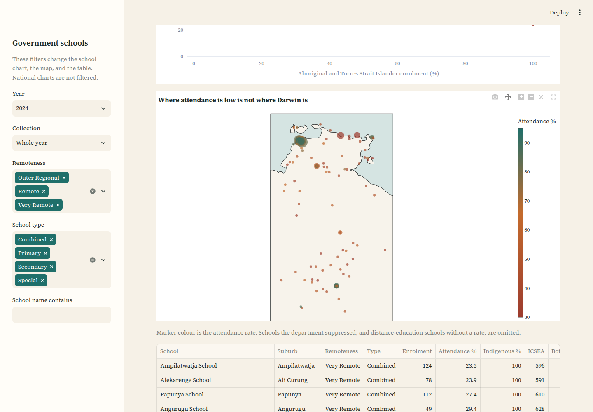
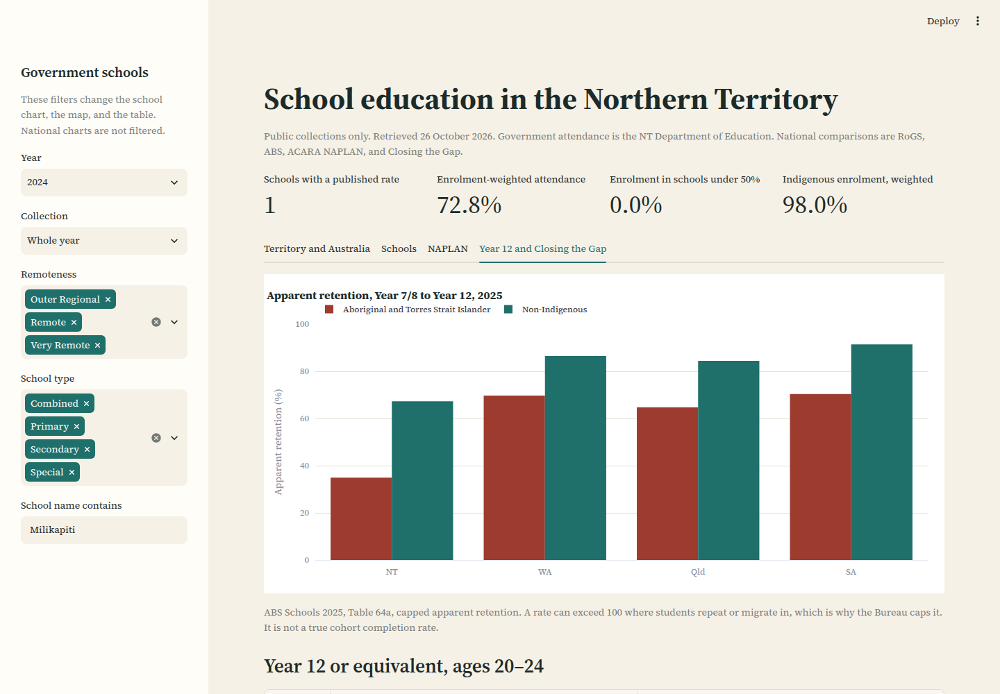

# Northern Territory school education

[](https://luciferdataengineer.github.io/nt-education-insights/)

A reproducible account of attendance, NAPLAN, retention and resourcing in Northern Territory schools, set against the rest of Australia. The grain runs from a national time series down to a government school. The numbers are the published ones. Nothing in the marts is imputed to fill a suppressed cell.

Aboriginal and Torres Strait Islander students in the NT attended **58.3%** of Years 1–10 in 2025, down from **68.6%** in 2016. Non-Indigenous students in the NT attended **89.4%**, the same as Australia (**89.7%**). In outer regional areas the Aboriginal rate matches the national figure (**77.1%** and **77.0%**). In very remote NT it is **45.8%**. The full reading is [INSIGHTS.md](INSIGHTS.md).

## Live dashboard

The static dashboard is published from [`dashboard/dist`](dashboard/dist/index.html):

**https://luciferdataengineer.github.io/nt-education-insights/**

Each push to `main` uploads that directory and deploys it with GitHub Actions (`.github/workflows/pages.yml`). The page embeds Plotly, so it is large and does not need a Python process. The site stays off until the repository owner sets **Settings → Pages → Build and deployment → Source** to **GitHub Actions**.

## Deploy the Streamlit app on Streamlit Community Cloud

The interactive app is separate from the static page. On [Streamlit Community Cloud](https://share.streamlit.io), create an app from this repository and set **Main file path** to `dashboard/app.py`. Community Cloud installs the root `requirements.txt`. The bronze files are already in the repository, the app adds `src/` to its path itself, and no secrets are required.

## Architecture

Bronze files are the publisher’s workbooks, saved as retrieved. Silver tables are tidy, with one grain and one meaning for a rate. Gold marts are the joins a chart needs. Quality checks fail the build when a published cell has been corrupted. Analysis writes the headline JSON and the static figures.



School names in the department workbooks are matched to ACARA school IDs. Exact normalised names first, then a token-sort fuzzy match. The 2024 whole-year match rate is **95.4%**. Unmatched schools stay in the attendance mart with a null ACARA id. They are not dropped, and they are not given someone else’s ICSEA.

## Headline numbers

| | |
| --- | --- |
| NT Aboriginal attendance, Years 1–10, 2025 | 58.3%, from 68.6% in 2016 |
| NT non-Indigenous, 2025 | 89.4% (Australia 89.7%) |
| Very remote NT, Aboriginal, 2025 | 45.8% (Australia very remote 54.2%; outer regional NT 77.1%) |
| Barkly government schools, Aboriginal, whole of 2024 | 40.3% (Darwin 72.4%) |
| NT Aboriginal Year 3 reading, needs additional support, 2025 | 71.7%, with 26.1% absent |
| Very remote NT, same cell | 89.6% needs support, 38.0% absent |
| NT Year 12 or equivalent, ages 20–24, 2021 | 40.2% (national target 96% by 2031; NT linear estimate 45.5%) |
| Government recurrent funding per student, 2023–24 | NT $32,223, Australia $26,140 |

## Layout

```
src/ntedu/          parsers, silver builders, DuckDB gold SQL, models, charts
dashboard/app.py    Streamlit app
dashboard/dist/     self-contained HTML dashboard
data/bronze/        raw workbooks and manifest.json (url, archive url, sha256)
data/silver/        tidy parquet
data/gold/          analytics marts
data/quality/       latest quality report
reports/            key_numbers.json, figures, screenshots
tests/              parsers, published-cell checks, dashboard build
```

## Data sources

Retrieved 26 October 2026. `data/bronze/manifest.json` records the URL, the retrieval path, the byte size and the sha256 of each file.

| Source | What was used | Licence and attribution |
| --- | --- | --- |
| [NT Department of Education enrolment and attendance](https://education.nt.gov.au/education/statistics-research-and-reports/enrolment-and-attendance) | Government school, region, remoteness and year-level workbooks, 2016–2025 | Attribute the Northern Territory Department of Education. Live pages returned a Cloudflare challenge to this environment, so the workbooks were recovered from the Internet Archive. Original and archive URLs are in the manifest. |
| [ACARA National Report on Schooling data portal](https://www.acara.edu.au/reporting/national-report-on-schooling-in-australia/data-portal) | School Profile 2008–2025, School Profile 2025, School Location 2025, Enrolments by Grade 2025, NAPLAN national results 2023, 2024 and 2026 | Attribute ACARA. NAPLAN from 2023 is the reset scale. School-level NAPLAN is not in this public file. |
| [ABS Schools, 2025](https://www.abs.gov.au/statistics/people/education/schools/2025) | Tables 35b, 43a, 46a, 53a, 64a, 90a | [CC BY 4.0](https://creativecommons.org/licenses/by/4.0/). Attribute the Australian Bureau of Statistics. |
| [Report on Government Services 2026, Part B, Section 4](https://www.pc.gov.au/ongoing/report-on-government-services/2026/child-care-education-and-training/school-education) | Attendance Tables 4A.16–4A.19 and recurrent expenditure Table 4A.32 | Attribute the Productivity Commission. |
| [Closing the Gap, Outcome 5](https://www.pc.gov.au/closing-the-gap-data/dashboard/se/outcome-area5) | Annual data compilation, March 2026, learning potential | Attribute the Productivity Commission and the Closing the Gap data compilation. |

Not used, and why:

- **data.nt.gov.au** does not publish these school enrolment and attendance workbooks. The department publishes them as Excel files.
- **My School** is a school-by-school site, not a bulk file. Profile, location and national NAPLAN results were taken from ACARA’s data portal instead.
- **ABS Census SEIFA** was left out. The socio-educational measure that joins to a school is ACARA’s SEA quarter and ICSEA. An area index would be a coarser geography than the school.

## Data dictionary

Rates in silver and gold are **proportions from 0 to 1**, except columns whose names end in `_pct` (0–100, the way ACARA and NAPLAN publish them) and Closing the Gap `value` (the unit column says which). `key_numbers.json` is in percentage points so it can be quoted directly.

### `gold/school_year.parquet`

One row per NT government school, collection and year, left-joined to the ACARA profile.

| Column | Meaning |
| --- | --- |
| `calendar_year`, `period` | `whole_year`, `term_1`, `term_3`, or `term_4` |
| `school_name` | Department name, footnote asterisks removed |
| `acara_id`, `match_method`, `match_score` | Link to ACARA. Null when unmatched |
| `enrolment` | Department student count. Null when suppressed |
| `attendance_rate` | Proportion of days attended. Null when suppressed or not collected |
| `geolocation` | ACARA: Outer Regional, Remote, Very Remote |
| `icsea`, `bottom_sea_pct`, `indigenous_pct`, `lbote_pct` | ACARA school profile. Percents are 0–100 |
| `latitude`, `longitude`, `lga_name`, `sa2_name` | ACARA school location |
| `attendance_band` | Under 50%, then 50, 70, 80, 90 |

### Other marts

| Mart | Grain |
| --- | --- |
| `gold/nt_region_year.parquet` | Harmonised region × population × period. `comparable_with_2020_boundaries` is false for East Arnhem and Top End before 2020 |
| `gold/nt_remoteness_year.parquet` | Department remoteness × region |
| `gold/nt_yearlevel_year.parquet` | Preschool through Year 12 |
| `gold/jurisdiction_attendance.parquet` | RoGS attendance, states and Australia |
| `gold/naplan_focus.parquet` | NAPLAN results for the subgroups used in the report |
| `silver/rogs_expenditure.parquet` | Recurrent expenditure per FTE student |
| `silver/abs_apparent_retention.parquet` | Capped apparent retention, as a proportion |
| `silver/ctg_outcome5.parquet` | Closing the Gap Outcome 5 in long form |

Populations on the NT files are `indigenous`, `non_indigenous` and `total`. On RoGS and Closing the Gap the population is the publisher’s label, kept as text.

## Cleaning

- Suppressed tokens (`np`, `..`, `-`, blank, `n/a`) become null. A later sum skips them. It does not treat them as zero.
- Attendance cells arrive as `81.5%`, as `81.5`, or as `0.815`. `parse_rate` writes a proportion. Values outside 0–1 are rejected rather than clipped.
- Footnote asterisks on school names are stripped and counted. Early files used them for RSAS and SEAM marks.
- Region names are harmonised in `src/ntedu/config.py`. The flag for the 2020 boundary change is kept on the mart.
- NAPLAN proficiency percents use assessed students as the denominator. Absence, exemption and withdrawal stay on their own columns, joined from the participation sheet where the results sheet does not carry them.
- Quality checks in `src/ntedu/quality.py` re-read published cells (Zuccoli Primary 2024, Barkly 2024, RoGS and Closing the Gap 2025, NAPLAN 2024) and fail if the match rate falls below 75%.

## Run it

Python 3.11 or newer.

```bash
python -m venv .venv
source .venv/bin/activate
pip install -e ".[dev]"
make all          # silver, gold, quality checks, figures, static dashboard
make test         # pytest
make lint         # ruff
```

`make all` does not download anything. The raw files are already in `data/bronze/`. Re-running it rebuilds parquet, `reports/key_numbers.json`, `reports/figures/` and `dashboard/dist/index.html`.

The static dashboard opens with no server:

```bash
open dashboard/dist/index.html
```

On Linux, `python -m http.server 8766 --directory dashboard/dist` and browse `http://127.0.0.1:8766`.

The Streamlit app:

```bash
streamlit run dashboard/app.py --server.port 8765
```

[NT school education](http://127.0.0.1:8765) is the interactive app. [Static dashboard](http://127.0.0.1:8766) is the single HTML file. The published copy is the [live dashboard](https://luciferdataengineer.github.io/nt-education-insights/).

## Screenshots











## Limitations

- Semester 1 national attendance and whole-year Territory attendance are different collections. The charts never plot them as one series.
- 2020 national attendance was not published.
- East Arnhem and Top End changed in 2020. The mart says so. Do not trend them through the break.
- Distance-education schools and cells under the department’s threshold have no attendance rate.
- NAPLAN means exclude students who were absent. In very remote NT that is more than a third of Year 3 Aboriginal students and close to half of Year 9.
- Apparent retention is capped and is not a cohort completion rate.
- The school regression describes co-movement. It is not an effect of remoteness, of Indigenous enrolment, or of funding.
- ACARA geolocation is the school’s remoteness, which is not always the student’s home remoteness.
- Non-government schools appear in RoGS, ABS and NAPLAN. The department’s school file is government schools only. In 2025, NT Aboriginal attendance was 57.3% in government schools and 63.4% in non-government schools. The territory figure is not being set by the non-government sector.

## Indigenous data sovereignty

These tables are government administrative data that were already public. They are not a community-owned dataset, and publishing a dashboard does not make them one. The [Maiam nayri Wingara principles](https://www.maiamnayriwingara.org/) and the CARE principles ask who defines the measures, who is accountable, and whether the data returns a benefit to the people they describe. This project does not meet that bar. It is a careful reading of releases that governments already circulate.

Practical consequences for this repo:

- Suppressed cells stay suppressed. There is no attempt to recover a school under the `np` threshold.
- Schools are not ranked. Residuals are labelled as residuals from a descriptive model, and flexible-learning settings are not compared with community schools as if they were the same service.
- Language in the report names the population the table names. Attendance is a property of a published aggregate, not a judgement of students or families.
- Anyone extending this with data that are not already public should be doing that under the direction of the communities concerned, not as a scrape.

## Tests

GitHub Actions runs `ruff check` and `pytest` on push and pull request (`.github/workflows/ci.yml`). The tests cover suppressed-cell parsing, the published Barkly and NAPLAN cells, the ACARA match rate, and a build of the static dashboard.

## Further work

School-level NAPLAN joined to attendance, if ACARA ever releases it with an absence model. A Year 7 to Year 12 cohort rather than apparent retention. Non-government schools at campus level, which the department workbook does not provide. Term-by-term movement inside a year, which the 2024 and 2025 files have started to publish beside the annual table.
